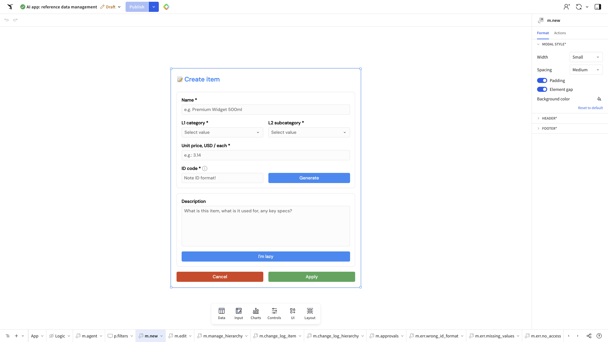
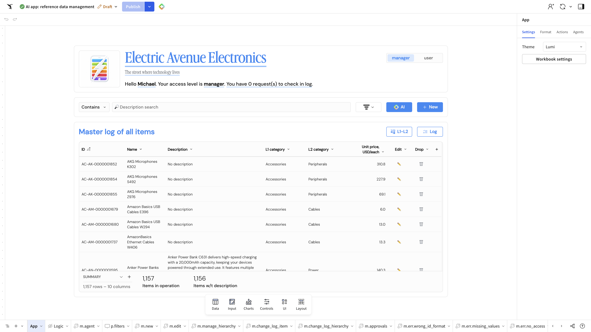

# Beauty — buttons and controls

Visual read only. Screenshots taken 2026-10-12 in the signed-in editor, theme named **Lumi** on the App page. Nothing here locks a CLI setting, a hex code, or an action sequence.

Docs were searched on [help.sigmacomputing.com/docs](https://help.sigmacomputing.com/docs) and [quickstarts.sigmacomputing.com](https://quickstarts.sigmacomputing.com). Both searches returned pages. No search failed. Retrieved 2026-10-12.

## Screenshots

Create item modal (`m.new`) with the format panel open: Width Small, Spacing Medium, Padding on, Element gap on.

App page: segmented manager / user, description search, filled AI and + New, outline L1-L2 and Log.

## Create item modal

The modal sits centered on a white canvas with a blue editor selection rectangle around it. The header is a pencil mark and bold black **Create item**. Required labels carry a red asterisk.

Fields, top to bottom:

- **Name** — white single-line input, light gray border, gray placeholder `e.g. Premium Widget 500ml`.
- **L1 category** and **L2 subcategory** — two white dropdowns side by side, gray borders, gray `Select value`, gray chevrons.
- **Unit price, USD / each** — white input, gray placeholder `e.g. 3.14`.
- **ID code** — white input, gray placeholder `Note ID format!`, with a small gray info mark on the label. To its right, **Generate** is a filled blue button with white text.
- **Description** — a taller white box, light gray border, gray placeholder `What is this item, what is it used for, any key specs?`.
- **I'm lazy** — a filled blue button, white text, stretched across the modal width.
- **Cancel** and **Apply** — a pair on one row. Cancel is filled red with white text. Apply is filled green with white text. They share the row width.

The open **Format** panel, under **Modal style**:

| Control | What is showing |
|---|---|
| Width | Small |
| Spacing | Medium |
| Padding | On, blue toggle |
| Element gap | On, blue toggle |
| Background color | Eyedropper and a blue **Reset to default** link. The modal surface reads as white. |
| Header | Collapsed |
| Footer | Collapsed |

The four colored buttons are inside the modal body. The footer section is closed, so this frame does not show whether the default footer buttons are visible.

## App page

Top card: logo, blue underlined **Electric Avenue Electronics**, gray tagline, and the greeting in black. At the right of that card, a segmented control: **manager** has a light blue fill and darker text; **user** is white with gray text.

Search row: a **Contains** menu, a long white **Description search** field with a gray border, a gray filter icon, then two filled blue buttons with white text and icons — sparkle **AI**, plus **+ New**.

Above the table’s right side, **L1-L2** and **Log** are outline buttons: white fill, light blue border, blue-gray icon and label.

The table itself shows a gold pencil in Edit and a gray trash icon in Drop. Those are column icons, separate from the page buttons.

Workbook chrome around the page, not page controls: a light gray **Draft** chip, a purple **Publish** button, and the right-hand **Theme** menu set to **Lumi**.

## What Sigma documents about this look

Button elements have three appearances: **Filled**, **Outline**, and **Text**. Style on a button sets font weight, text color, and button color. A button can be text, icon, or text and icon, and its shape can be Auto, Square, Round, or Pill. ([Button elements](https://help.sigmacomputing.com/docs/button-elements))

A workbook theme **Highlight** color is the color of buttons, link text, and selection indicators. **Surface** covers element backgrounds, borders, and icons. Corner shape for the theme is square, rounded, or pill, and the default is round. ([Create and manage workbook themes](https://help.sigmacomputing.com/docs/create-and-manage-workbook-themes)) A custom theme can still be overridden on an individual element. ([Fundamentals 07: Design Elements](https://quickstarts.sigmacomputing.com/guide/fundamentals_7_design_v3/index.html))

Modal format matches the open panel. Width choices are Extra small, Small, Medium, Large, and Extra large, and the default is Small. Spacing is Small, Medium, or Large, and the default is Medium. Padding and element gap are on by default. A modal background color does not paint the footer. The default footer has two buttons, labeled Primary and Secondary so they follow the color styling. Custom buttons can also sit in the modal body, outside that footer. ([Use modals to create focused content views](https://help.sigmacomputing.com/docs/use-modals-to-create-focused-content-views)) A quickstart builds its own Submit button and sets Cancel to Outline, then turns off the default footer buttons. ([Crowdsource Ideas with a Sigma AI App](https://quickstarts.sigmacomputing.com/guide/dataapps_crowd_sourcing/index.html)) Lesson six renames the footer Primary and Secondary buttons and sets a duplicate on-page button to Outline. ([Lesson six: Organization](https://help.sigmacomputing.com/docs/lesson-six-organization))

A segmented control is one to seven single-select segments. On Format, the label has a text color, and values that do not fit become a dropdown. ([Create and configure a segmented control](https://help.sigmacomputing.com/docs/segmented-control)) Control format covers background, border, padding, corner shape, placeholder text, and label text color. ([Create and manage a control element](https://help.sigmacomputing.com/docs/create-and-manage-a-control-element))

The docs name the style slots. They do not publish the blue, red, and green fills in these screenshots, and they do not publish a Lumi palette.

## Draft for review

Colors actually visible in the two screenshots. No hex was measured.

- **Generate** — filled blue, white text
- **I'm lazy** — filled blue, white text
- **Cancel** — filled red, white text
- **Apply** — filled green, white text
- **AI** — filled blue, white text, sparkle icon
- **+ New** — filled blue, white text, plus icon
- **L1-L2** — outline, light blue border, white fill
- **Log** — outline, light blue border, white fill
- **manager** (selected segment) — light blue fill
- **user** (unselected segment) — white fill, gray text
- **Text inputs, dropdowns, description box, search** — white fill, light gray border, gray placeholder
- **Required asterisks** — red
- **Padding and Element gap toggles** — blue when on
- **Reset to default** — blue text
- **Electric Avenue Electronics** — blue, underlined
- **Edit pencil** — gold
- **Drop trash icon** — gray
- **Editor selection rectangle** around the modal — blue
- **Publish** — purple (header chrome)
