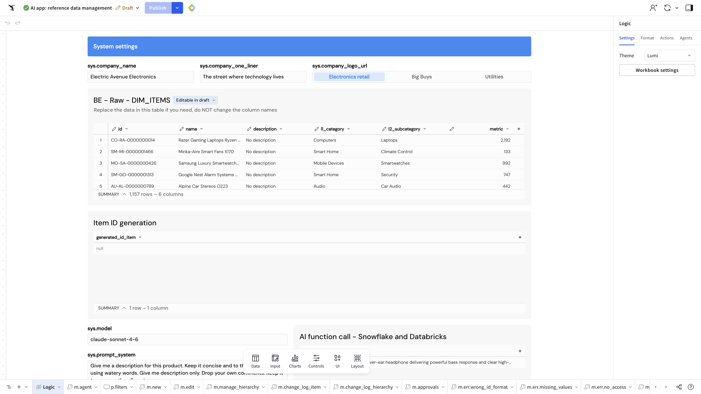

# Table beauty — visual notes

Visual read of two editor screenshots. Names come from `00-inventory.md`. Theme shown in the editor side panel on both frames: **Lumi**. Nothing here is a locked CLI setting.

Screenshots:

`/Users/michael.khmelik/dev/sigma-playwrite-cli/research/screenshots/beauty-tables-01-raw-items.png`

`/Users/michael.khmelik/dev/sigma-playwrite-cli/research/screenshots/beauty-containers-01-app.png`

## What is on screen

| Screenshot | Page | Table title | Inventory name |
|---|---|---|---|
| `beauty-tables-01-raw-items.png` | Logic | BE – Raw – DIM_ITEMS | `BE - Raw - DIM_ITEMS` |
| `beauty-containers-01-app.png` | App | Master log of all items | Master log of all items |

The Logic frame also shows a small table under **Item ID generation**, titled by the column `generated_id_item`. It is noted only so it is not confused with the raw item table.

## BE - Raw - DIM_ITEMS

The table sits in a light gray panel on the Logic page. The title is bold and dark. Beside it is a small pill, **Editable in draft**. Under the title is a one-line note: replace the data in this table if you need to, and do not change the column names.

**Header.** One header row, light gray, darker than the body. Labels are lowercase and bold, with a small sort caret on each named column: `id`, `name`, `description`, `l1_category`, `l2_subcategory`, `metric`. A pencil glyph sits in the header band between `l2_subcategory` and `metric`. The summary still reads **6 columns**, which matches those six names in the inventory. The pencil is an icon in the header, not a confirmed seventh field.

**Borders.** Body rows are separated by thin light-gray horizontal rules. A line also sits under the header. No strong vertical grid is visible between columns. A narrow gutter on the left shows row numbers (1–5 in this crop). That gutter is edit-mode chrome on this frame; it is not a labeled data column.

**Rounding.** The gray panel reads mostly flat. Corner radius is not obvious in this crop. The blue **System settings** bar above it is a separate rounded bar, not part of this table.

**Row banding.** Data rows look uniformly white. No alternating gray band is visible on this table.

**Summary footer.** A footer bar is open under the rows. It is labeled **SUMMARY**, with a caret, and reads **1,157 rows – 6 columns**. No extra named aggregates are visible in that bar.

**Icon columns.** No trash icon. The only icon on this table is the pencil in the header band described above. Body cells in the crop are text and numbers, not icon buttons.

## Master log of all items

The table is the main card on the App page. The card is white, with a light outer border and slightly rounded corners. The bold title **Master log of all items** sits inside the card, above the grid. At the card’s top right are two small buttons, **L1-L2** and **Log**. They are page controls, not table columns.

**Header.** One header row, light gray, bold, darker than the body. Visible labels, with sort carets on the data columns: **ID**, **Name**, **Description**, **L1 category**, **L2 category**, **Unit price, USD/each**, **Edit**, **Drop**. Edit and Drop are narrow and do not show a sort caret in this crop.

**Borders.** Thin light-gray horizontal rules separate the rows, including a rule under the header. Vertical lines between columns are not apparent. The card’s own edge is a separate light border around the whole element.

**Rounding.** The white card has a small, even corner radius. It reads as a rounded rectangle, not a pill and not a sharp square.

**Row banding.** Data rows alternate white and a very light gray. The band is faint and runs the full width of the row.

**Summary footer.** A footer bar is open under the last visible row. It is labeled **SUMMARY**, with a caret, and reads **1,157 rows – 10 columns**. Two named summaries sit in the same bar: **Items in operation** 1,157 and **Items w/t description** 1,156. Eight headers are visible in the crop. The footer’s count of 10 columns means two columns are outside this frame.

**Icon columns.** Inventory names these Edit (pencil) and Drop (trash).

- **Edit:** a small yellow-gold pencil, one per row, centered in a narrow column. No filled or outlined button shape is visible behind the glyph.
- **Drop:** a small gray trash can, one per row, same narrow treatment. No button fill is visible.

## generated_id_item (same Logic frame)

A short single-column table. Header: `generated_id_item`, with a caret. One visible body cell reads `null`. Footer: **SUMMARY**, **1 row – 1 column**. Same light header and thin horizontal rule as the raw table. No pencil, no trash, no obvious banding, no rounded card of its own.

## How Sigma docs name these looks

Help docs (searched `https://help.sigmacomputing.com/docs`):

- **Header, cell borders, banding.** [Format and customize a table](https://help.sigmacomputing.com/docs/format-and-customize-a-table) calls cell borders **Grid lines** (No grid, Vertical grid, Horizontal grid, All grid), alternating row color **Banding** (a banding color, or None), and the header row **Header format** (font, weight, color, alignment, background, divider). The same page’s **Table components** section has **Show summary bar**. **Format action button columns** on that page is the documented control for columns that trigger an action: Appearance Filled, Outline, or Text. Spreadsheet preset defaults to Text; Presentation preset defaults to Outline. The pencils and trash cans in these screenshots look like bare glyphs, closer to Text than to a filled or outline button. That is a visual impression, not a confirmed setting.
- **Summary values.** [Create and manage tables](https://help.sigmacomputing.com/docs/create-and-manage-tables) describes the **SUMMARY** bar: Show summaries, then Add summary (row count, an aggregate column, or a custom formula). That matches the open **SUMMARY** footers, including the two named counts on the master log.
- **Outer border and rounding.** [Customize element background and styles](https://help.sigmacomputing.com/docs/customize-element-background-and-styles) is separate from table grid lines. Element style sets padding, background, a **Border** of 1, 2, or 3 pixels (padding is required before a non-image element can take a border), and **Corner**: square, round, or pill. The master log’s white edge and slight radius are this element chrome. Grid lines are the rules inside the grid.
- **Theme defaults.** [Create and manage workbook themes](https://help.sigmacomputing.com/docs/create-and-manage-workbook-themes) puts **Corner** under Layout style (square, rounded, or pill; default round) and puts presets, cell spacing, grid lines, banding color, header, and cell under Table style. The editor shows theme **Lumi**. These screenshots are not a readout of that theme’s saved values.

Quickstarts (searched `https://quickstarts.sigmacomputing.com`):

- [Fundamentals 02: Data](https://quickstarts.sigmacomputing.com/guide/fundamentals_2_data_v3/index.html) names the two table presets, **Spreadsheet** and **Presentation**, and the Format panel in the element panel. It also shows a low-contrast warning when a header’s text and background are too close. It does not name grid lines or banding.
- [Fundamentals 07: Design Elements](https://quickstarts.sigmacomputing.com/guide/fundamentals_7_design_v3/index.html) has a **TABLE STYLE** section with top-level options plus Header, Subheader, and Cell, and a Layout style control for padding. It does not name banding or grid lines.

A quickstarts search for banding, alternating row color, and grid lines did not return a page that uses those words. Banding and grid lines are documented on the help site, not in the quickstarts that came back.

## Side by side

| | BE - Raw - DIM_ITEMS | Master log of all items |
|---|---|---|
| Header | Light gray, bold, lowercase field names, sort carets | Light gray, bold, title-case labels, sort carets on data columns |
| Inner borders | Thin horizontal rules; header divider | Thin horizontal rules; header divider |
| Outer edge | Light gray panel; radius not clear | White card, light border, slight rounding |
| Row banding | Not visible; rows look white | Faint white / light-gray alternate rows |
| Summary footer | Open. 1,157 rows – 6 columns | Open. 1,157 rows – 10 columns, plus two named counts |
| Icons | Pencil glyph in the header band only | Yellow pencil (Edit) and gray trash (Drop) on every visible row |

## Draft for review

- Confirm the raw table’s banding is off, and that the flat white rows are not a band too faint to see in the screenshot.
- Confirm the master log’s alternate gray is table banding, not a conditional-format rule.
- Confirm both tables use horizontal grid lines only.
- Confirm the master-log card corner is Round, and whether the raw table’s gray is the element background or a parent container.
- Confirm Edit and Drop are action columns on Text appearance, not image columns and not Filled or Outline buttons.
- Confirm the raw-table pencil is input-table chrome and is not a seventh column. The footer says 6 columns.
- Name the two master-log columns that are outside this crop (footer says 10; eight headers are visible).
- Do not lock any of the above as CLI settings until this list is reviewed.
